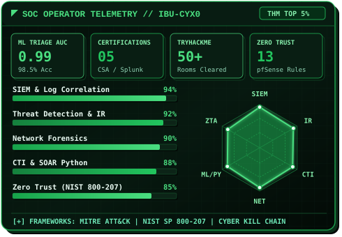

<div align="center">

<!-- ANIMATED CYBER HEADER BANNER -->


<!-- ANIMATED TERMINAL TYPING SVG -->
<a href="https://ibrahim-cybrx.is-a.dev/">

</a>

<!-- QUICK ACTION HUD LINKS -->


</div>

<!-- OPERATOR TELEMETRY & HEATMAP -->
<div align="center">

<h3><code>ibu-cyx0@soc-hq \~ \$ ./contributions.sh</code></h3>


<h3><code>ibu-cyx0@soc-hq \~ \$ whoami --telemetry</code></h3>
<table>
<tr>
<td valign="top"></td>
<td valign="top"></td>
</tr>
</table>


</div>


## `cat /etc/operator_dossier.txt`

```
╔══════════════════════════════════════════════════════════════════════════════╗
║  [+] SOC WORKSTATION // NODE: ibu-cyx0@soc-hq                  [ONLINE ●]    ║
╠══════════════════════════════════════════════════════════════════════════════╣
║  ┌───────────────────────────────────┐  ┌─────────────────────────────────┐  ║
║  │ OPERATOR : Mohamed Ibrahim H      │  │ RANK   : TryHackMe Top 4% (60+) │  ║
║  │ ROLE     : SOC Analyst | Blue Team│  │ STATUS : Open to L1 SOC Roles   │  ║
║  │ LOCATION : Tamil Nadu, India      │  │ DEGREE : B.E. Cyber Security    │  ║
║  │ FOCUS    : SIEM · CTI · IR · ZTA  │  │ PAPER  : IJARIIT Vol.11 (2025)  │  ║
║  └───────────────────────────────────┘  └─────────────────────────────────┘  ║
╠══════════════════════════════════════════════════════════════════════════════╣
║  [>] FIELD EXPERIENCE                                                        ║
║      [✓] SOC Analyst Intern — The Mind IT (Jan–Apr 2026 | Hybrid)            ║
║          • Triaged & correlated security alerts across Splunk & Wazuh SIEM   ║
║          • Investigated IOCs to filter false positives & escalate incidents  ║
║                                                                              ║
║  [>] VERIFIED CERTIFICATIONS & RECOGNITION                                   ║
║      [✓] EC-Council Certified SOC Analyst (CSA)                              ║
║      [✓] Cisco Certified CyberOps Associate                                  ║
║      [✓] Splunk Core Certified User                                          ║
║      [✓] EC-Council Ethical Hacking Essentials (EHE)                         ║
║      [✓] Wazuh Ambassador (Certificate of Recognition)                       ║
║                                                                              ║
║  [>] MISSION : "Defend systems before attackers find the door open."         ║
╚══════════════════════════════════════════════════════════════════════════════╝

```


## `cat /etc/defensive_arsenal.conf`

<table>
<tr>
<td width="50%" valign="top">

### 🛡️ SIEM, XDR & SOC Operations

### 📡 Network Forensics & Perimeter

```
╔══════════ [ SOC PLAYBOOK CORE ] ══════════╗
║ ▸ L1 Alert Triage & False-Positive Tuning ║
║ ▸ Splunk SPL & Microsoft Sentinel KQL     ║
║ ▸ Phishing Header & IOC Enrichment        ║
║ ▸ Escalation & Incident Documentation     ║
╚═══════════════════════════════════════════╝

```

</td>
<td width="50%" valign="top">

### 💻 Security Automation & Infra

### 🧬 Threat Intel & Frameworks

```
╔════════ [ DETECTION ENGINEERING ] ════════╗
║ ▸ Custom Wazuh MITRE ATT&CK Rules (7+)    ║
║ ▸ pfSense Micro-Segmentation (13 Rules)   ║
║ ▸ Automated CTI Feeds & STIX 2.1 Export   ║
║ ▸ ML Alert Triage & Threshold Calibration ║
╚═══════════════════════════════════════════╝

```

</td>
</tr>
</table>


## `ls ~/projects/ --sort=impact`

```
   [1] CTI AUTOMATION             [2] ZERO TRUST LAB              [3] AI SOC TRIAGE
  ┌───────────────────┐          ┌───────────────────┐          ┌───────────────────┐
  │ OTX + AbuseIPDB   │  IOCs    │ 6-Zone pfSense +  │  Alerts  │ Random Forest PDP │
  │ + URLhaus → SIEM  ├─────────►│ 5-Factor PDP +    ├─────────►│ Threshold Matrix  │
  │ (Splunk / KQL)    │          │ Wazuh MITRE Rules │          │ + Analyst Loop    │
  └───────────────────┘          └───────────────────┘          └───────────────────┘
        ENRICHMENT                    ENFORCEMENT                 PRIORITIZATION

```

<table>
<tr>
<td width="100%" valign="top">

### 🔥 [CTI Automation Platform](https://github.com/ibu-cyx0/CTI-Automation-Platform)    

> **Multi-Feed Cyber Threat Intelligence Collector & SIEM Correlation Console**

* **Automated Multi-Feed Ingestion**: Collects, normalizes, and deduplicates IPs, domains, URLs, and SHA-256 hashes from AlienVault OTX, AbuseIPDB, and URLhaus via Python REST APIs.

* **Actionable SOC Triage**: Correlates IOCs against Splunk SPL & Microsoft Sentinel KQL queries, exports UUIDv4 STIX 2.1 bundles, and maps threat origins in a live console.

</td>
</tr>
<tr>
<td width="100%" valign="top">

### 🤖 [AI-Powered SOC Alert Triage Workbench](https://github.com/ibu-cyx0/AI-Powered-Threat-Detection-Engine)    

> **Random Forest Alert Prioritization, Threshold Calibration & Analyst Feedback Loop**

* **Validated ML Evaluation**: Trained across 6 SOC telemetry features (`PR-AUC: 0.986`, `Brier: 0.021`), with an explicit ablation test without `alert_priority` (`91.2%`) to verify non-circular signal.

* **Human-in-the-Loop SOC Workflow**: Interactive decision-threshold slider linked live to the confusion matrix, per-alert feature contributions, persistent FP/TP overrides, and retraining-queue CSV export.

</td>
</tr>
<tr>
<td width="100%" valign="top">

### 🛡️ [Zero Trust Network Simulation Lab](https://github.com/ibu-cyx0/Zero-Trust-Network-Simulation-Lab)    

> **NIST SP 800-207 Micro-Segmentation, 5-Factor PDP Engine & Wazuh MITRE ATT&CK Correlation**

* **Least-Privilege Micro-Segmentation**: Engineered 6 isolated segments (`MGMT / SOC / DEV / DMZ / GUEST / INTERNET`) enforced by 13 pfSense rules (`5 ALLOW`, `8 DENY`) with live hit counters and decision traces.

* **Continuous Verification & Stateful SIEM**: Weighted 5-factor PDP (Role, Segment, Posture, MFA, `08:00–19:59 UTC`) paired with 7 custom Wazuh rules including stateful 60-second brute-force correlation (`T1110`).

</td>
</tr>
</table>


## `ls -la ~/certifications_and_research/`

<div align="center">

| Credential / Milestone | Issuing Body / Venue | Domain & Impact | 
| ----- | ----- | ----- | 
| 🏆 **Certified SOC Analyst (CSA)** | EC-Council | Tier-1/Tier-2 SOC Operations, SIEM & Incident Response | 
| 🏆 **CyberOps Associate** | Cisco | Network Security Operations & Protocol Forensics | 
| 🏆 **Core Certified User** | Splunk | SPL Queries, Dashboards & Log Correlation | 
| 🏆 **Ethical Hacking Essentials (EHE)** | EC-Council | Attack Surface Analysis & Defensive Countermeasures | 
| 🏆 **Wazuh Ambassador** | Wazuh | Open-Source SIEM / XDR Community Recognition | 
| 📄 **Published Research (2025)** | *IJARIIT* (Vol. 11, Issue 1) | *"Creating Tailored Detection and Prevention Mechanisms for Targeted Threats"* | 
| 🎤 **Technical Seminar Speaker** | College Tech Symposium | Delivered *"AI-Powered Threat Detection in SOC"* to **150+ students** | 

</div>

## `cat /var/log/activity.log`

```
[2026] ──► Zero Trust Lab v2 (NIST 800-207 · 13 pfSense · 7 Wazuh Rules) .. [ LIVE       ✓ ]
[2026] ──► AI SOC Triage Workbench (98.5% Acc · 0.989 CV AUC · Ablation) .. [ LIVE       ✓ ]
[2026] ──► CTI Automation Platform (OTX + AbuseIPDB + URLhaus + STIX 2.1) . [ LIVE       ✓ ]
[2026] ──► Wazuh Ambassador Certificate of Recognition .................... [ RECOGNIZED ✓ ]
[2026] ──► SOC Analyst Internship — The Mind IT (Splunk & Wazuh) .......... [ COMPLETE   ✓ ]
[2026] ──► TryHackMe Global Ranking: Top 4% (60+ Rooms Completed) ......... [ ACTIVE     ✓ ]
[2026] ──► EC-Council Certified SOC Analyst (CSA) ......................... [ CERTIFIED  ✓ ]
[2026] ──► B.E. Cyber Security — Paavai Engineering College ............... [ COMPLETE   ✓ ]
[2025] ──► Published Threat Detection Research — IJARIIT Vol. 11, Issue 1 . [ PUBLISHED  ✓ ]
[2025] ──► Splunk Core Certified User & Cisco CyberOps Associate .......... [ CERTIFIED  ✓ ]

```

<div align="center">

```
╔═══════════════════════════════════════════════════════╗
║  "Attackers only need to be right once.               ║
║   Defenders need to be right every time."             ║
║                                    — Blue Team Code   ║
╚═══════════════════════════════════════════════════════╝

```

<!-- ANIMATED CYBER FOOTER BANNER -->


</div>
