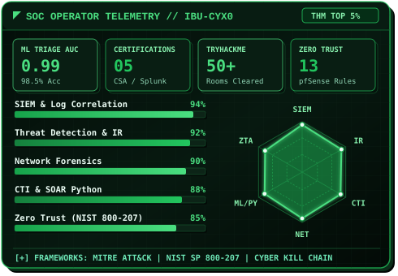

<div align="center">

<h3><code>ibu-cyx0@github ~ $ ./contributions.sh</code></h3>


<br><br>

<h3><code>ibu-cyx0@github ~ $ whoami</code></h3>
<table>
  <tr>
    <td valign="top"></td>
    <td valign="top"></td>
  </tr>
</table>

<br>

<h3><code>ibu-cyx0@github ~ $ ./links.sh</code></h3>

[](https://ibrahim-cybrx.is-a.dev/)
[](https://linkedin.com/in/mohamed-ibrahim-h-585b92282)
[](https://tryhackme.com/p/IbrahimCyb3r4)
[](https://x.com/CybrxIbrahim)
[](mailto:ibrahim.cybrx@gmail.com)

</div>

<br>

## `cat profile.txt`

```text
╔══════════════════════════════════════════════════════════════════════════════╗
║  [+] SOC WORKSTATION // NODE: ibu-cyx0@soc-hq                  [ONLINE ●]    ║
╠══════════════════════════════════════════════════════════════════════════════╣
║  ┌───────────────────────────────────┐  ┌─────────────────────────────────┐  ║
║  │ OPERATOR : Mohamed Ibrahim H      │  │ RANK   : TryHackMe Top 5% (50+) │  ║
║  │ ROLE     : SOC Analyst | Blue Team│  │ STATUS : Actively Hunting       │  ║
║  │ LOCATION : Tamil Nadu, India      │  │ DEGREE : B.E. Cyber Security    │  ║
║  │ FOCUS    : SIEM · CTI · IR · ZTA  │  │ PAPER  : IJARIIT Vol.11 (2025)  │  ║
║  └───────────────────────────────────┘  └─────────────────────────────────┘  ║
╠══════════════════════════════════════════════════════════════════════════════╣
║  [>] EXPERIENCE                                                              ║
║      [✓] SOC Analyst Intern — The Mind IT (Jan–Apr 2026 | Hybrid)            ║
║          • Triaged & correlated security alerts across Splunk & Wazuh SIEM   ║
║          • Investigated IOCs to filter false positives & escalate incidents  ║
║                                                                              ║
║  [>] VERIFIED CERTIFICATIONS & RECOGNITION                                   ║
║      [✓] EC-Council Certified SOC Analyst (CSA)                              ║
║      [✓] EC-Council Ethical Hacking Essentials (EHE)                         ║
║      [✓] Splunk Core Certified User                                          ║
║      [✓] Cisco Certified CyberOps Associate                                  ║
║      [✓] Wazuh Ambassador (Certificate of Recognition)                       ║
║                                                                              ║
║  [>] MISSION : "Defend systems before attackers find the door open."         ║
╚══════════════════════════════════════════════════════════════════════════════╝
```

<br>

## `cat /etc/skills.conf`

<table>
<tr>
<td width="50%" valign="top">

### 🛡️ SIEM, XDR & Threat Defense


### 📡 Network Forensics & Perimeter


```text
┌──────── [ BLUE TEAM READINESS ] ────────┐
│ Security Monitoring  ███████████░  94%  │
│ Threat Detection     ███████████░  92%  │
│ Incident Response    ██████████░░  88%  │
│ Log Correlation      ███████████░  94%  │
│ Threat Intelligence  █████████░░░  85%  │
│ Zero Trust (800-207) █████████░░░  85%  │
└─────────────────────────────────────────┘
```

</td>
<td width="50%" valign="top">

### 💻 Security Automation & Infra


### 🧬 Threat Intel & Frameworks


```text
┌──────── [ NETWORK & PROTOCOL ] ─────────┐
│ TCP/IP Stack         ███████████░  92%  │
│ Packet Forensics     ███████████░  92%  │
│ DNS / HTTP / TLS     ███████████░  90%  │
│ Firewall Rule Eng.   ██████████░░  88%  │
│ Active Directory/IAM █████████░░░  82%  │
│ SIEM Rule Authoring  ███████████░  92%  │
└─────────────────────────────────────────┘
```

</td>
</tr>
</table>

<br>

## `ls ~/projects/ --sort=impact`

<table>
<tr>
<td width="50%" valign="top">

### 🔥 [CTI Automation Platform](https://github.com/ibu-cyx0/cti-automation-platform) `FLAGSHIP`
> **Automated Cyber Threat Intelligence & Splunk Correlation Pipeline**

```text
┌──────────────┐    ┌───────────────┐    ┌───────────────┐
│ OTX/AbuseIPDB├───►│ Python Engine ├───►│ Splunk SIEM   │
│ + URLhaus    │    │ Deduplication │    │ Live Dashboard│
└──────────────┘    └───────────────┘    └───────────────┘
```
* **Multi-Feed Ingestion**: Automated IOC collection across AlienVault OTX, AbuseIPDB & URLhaus via Python REST APIs.
* **Real-Time SIEM Matching**: Correlates live IOCs against firewall/proxy logs in Splunk with automated severity tagging (`CRITICAL` to `LOW`).

</td>
<td width="50%" valign="top">

### 🤖 [AI SOC Alert Triage System](https://github.com/ibu-cyx0/ml-alert-triage) `ML // 0.99 AUC`
> **Machine Learning False-Positive Reduction Engine for Tier-1/Tier-2 SOC**

```text
┌──────────────┐    ┌───────────────┐    ┌───────────────┐
│ 2,000 Alerts ├───►│ Random Forest ├───►│ TP ► Tier 2   │
│ 10 Features  │    │ 98.5% Test Acc│    │ FP ► AutoClose│
└──────────────┘    └───────────────┘    └───────────────┘
```
* **High-Precision Triage**: Trained a Random Forest classifier on 2,000 synthetic labeled SOC alerts, achieving **98.5% test accuracy** and **0.99 ROC-AUC**.
* **Automated Escalation**: Scores alert confidence and escalates verified `CRITICAL` true positives to Tier 2, auto-closing false positives.

</td>
</tr>
<tr>
<td width="50%" valign="top">

### 🛡️ Zero Trust Network Simulation Lab `NIST 800-207`
> **4-Zone Micro-Segmented Architecture & MITRE ATT&CK SIEM Detection**

```text
┌──────────────┐    ┌───────────────┐    ┌───────────────┐
│ 4-Zone Net   ├───►│ Python ZTA    ├───►│ Wazuh SIEM    │
│ 13 pfSense   │    │ Policy Engine │    │ 6 ATT&CK Rules│
└──────────────┘    └───────────────┘    └───────────────┘
```
* **Micro-Segmentation**: Engineered `SOC / DEV / MGMT / GUEST` zones per **NIST SP 800-207** with 13 custom pfSense default-deny firewall rules.
* **Continuous Verification**: Built a Python Zero Trust Policy Engine (device trust, MFA, role, IP, time) paired with 6 MITRE ATT&CK rules in Wazuh.

</td>
<td width="50%" valign="top">

### 🏠 [SOC Home Lab](https://github.com/ibu-cyx0/soc-home-lab) & 🌐 [Packet Forensics](https://github.com/ibu-cyx0/network-traffic-analysis) `SIEM + PCAP`
> **End-to-End SIEM Correlation & Deep Packet Inspection Workflows**

```text
┌──────────────┐    ┌───────────────┐    ┌───────────────┐
│ Wireshark/PCAP├──►│ Scapy / Rules ├───►│ Splunk + Wazuh│
│ DNS/HTTP/TCP │    │ C2 & BruteFrc │    │ IR Playbooks  │
└──────────────┘    └───────────────┘    └───────────────┘
```
* **SIEM Detection Engineering**: Built custom brute-force and anomalous authentication detection rules across Splunk and Wazuh.
* **Protocol Forensics**: Captured and dissected live HTTP, DNS, and TCP traffic using Wireshark and Scapy to uncover C2 patterns.

</td>
</tr>
</table>

<br>

## `ls -la ~/certifications_and_research/`

<div align="center">

| Credential / Milestone | Issuing Body / Venue | Domain & Impact |
|:---|:---|:---|
| 🏆 **Certified SOC Analyst (CSA)** | EC-Council | Tier-1/Tier-2 SOC Operations, SIEM & Incident Response |
| 🏆 **CyberOps Associate** | Cisco | Network Security Operations & Protocol Forensics |
| 🏆 **Core Certified User** | Splunk | SPL Queries, Dashboards & Log Correlation |
| 🏆 **Ethical Hacking Essentials (EHE)** | EC-Council | Attack Surface Analysis & Defensive Countermeasures |
| 🏆 **Wazuh Ambassador** | Wazuh | Open-Source SIEM / XDR Community Recognition |
| 📄 **Published Research (2025)** | *IJARIIT* (Vol. 11, Issue 1) | *"Creating Tailored Detection and Prevention Mechanisms for Targeted Threats"* |
| 🎤 **Technical Seminar Speaker** | College Tech Symposium | Delivered *"AI-Powered Threat Detection in SOC"* to **150+ students** |

</div>

<br>

## `cat /var/log/activity.log`

```text
[2026] ──► Wazuh Ambassador Certificate of Recognition .................... [ RECOGNIZED ✓ ]
[2026] ──► SOC Analyst Internship — The Mind IT (Splunk & Wazuh) .......... [ COMPLETE   ✓ ]
[2026] ──► Zero Trust Network Lab (NIST SP 800-207 · 13 pfSense Rules) .... [ COMPLETE   ✓ ]
[2026] ──► CTI Automation Platform (OTX + AbuseIPDB + URLhaus) ............ [ COMPLETE   ✓ ]
[2026] ──► AI SOC Alert Triage System (98.5% Acc · 0.99 ROC-AUC) .......... [ COMPLETE   ✓ ]
[2026] ──► TryHackMe Global Ranking: Top 5% (50+ Rooms Completed) ......... [ ACTIVE     ✓ ]
[2026] ──► EC-Council Certified SOC Analyst (CSA) ......................... [ CERTIFIED  ✓ ]
[2026] ──► B.E. Cyber Security — Paavai Engineering College ............... [ COMPLETE   ✓ ]
[2025] ──► Published Threat Detection Research — IJARIIT Vol. 11, Issue 1 . [ PUBLISHED  ✓ ]
[2025] ──► Splunk Core Certified User & Cisco CyberOps Associate .......... [ CERTIFIED  ✓ ]
[2025] ──► SOC Home Lab (Splunk + Wazuh) & Wireshark Traffic Forensics .... [ COMPLETE   ✓ ]
```

<br>

<div align="center">

```text
╔═══════════════════════════════════════════════════════╗
║  "Attackers only need to be right once.               ║
║   Defenders need to be right every time."             ║
║                                    — Blue Team Code   ║
╚═══════════════════════════════════════════════════════╝
```

</div>
