<h3><code>ibu-cyx0@github ~ $ ./contributions.sh</code></h3>

<h3><code>ibu-cyx0@github ~ $ whoami</code></h3>
<table>
<tr>
<td valign="top"></td>
<td valign="top"></td>
</tr>
</table>

<h3><code>ibu-cyx0@github ~ $ ./links.sh</code></h3>

cat profile.txt

╔══════════════════════════════════════════════════════════════════════════════╗
║  [+] SOC WORKSTATION // NODE: ibu-cyx0@soc-hq                  [ONLINE ●]    ║
╠══════════════════════════════════════════════════════════════════════════════╣
║  ┌───────────────────────────────────┐  ┌─────────────────────────────────┐  ║
║  │ OPERATOR : Mohamed Ibrahim H      │  │ RANK   : TryHackMe Top 4% (60+) │  ║
║  │ ROLE     : SOC Analyst | Blue Team│  │ STATUS : Actively Hunting       │  ║
║  │ LOCATION : Tamil Nadu, India      │  │ DEGREE : B.E. Cyber Security    │  ║
║  │ FOCUS    : SIEM · CTI · IR · ZTA  │  │ PAPER  : IJARIIT Vol.11 (2025)  │  ║
║  └───────────────────────────────────┘  └─────────────────────────────────┘  ║
╠══════════════════════════════════════════════════════════════════════════════╣
║  [>] EXPERIENCE                                                              ║
║      [✓] SOC Analyst Intern — The Mind IT (Jan–Apr 2026 | Hybrid)            ║
║          • Triaged 40+ daily alerts across Splunk & Wazuh (15-min SLA)       ║
║          • Investigated 30+ weekly anomalies via SPL & OSINT validation      ║
║          • Reduced recurring false positives by ~25% via Wireshark & tuning  ║
║                                                                              ║
║  [>] VERIFIED CERTIFICATIONS & RECOGNITION                                   ║
║      [✓] EC-Council Certified SOC Analyst (CSA)                              ║
║      [✓] EC-Council Ethical Hacking Essentials (EHE)                         ║
║      [✓] Splunk Core Certified User                                          ║
║      [✓] Cisco Certified CyberOps Associate                                  ║
║      [✓] Wazuh Ambassador (Certificate of Recognition)                       ║
║                                                                              ║
║  [>] MISSION : "Defend systems before attackers find the door open."         ║
╚══════════════════════════════════════════════════════════════════════════════╝

cat /etc/skills.conf

<table>
<tr>
<td width="50%" valign="top">

🛡️ SIEM, XDR & Threat Defense

📡 Network Forensics & Perimeter

┌───────── [ BLUE TEAM TELEMETRY ] ─────────┐
│ SIEM Triage       : Splunk SPL + Wazuh    │
│ False Positives   : ~25% Tuning Reduction │
│ Incident SLA      : 15-Min Escalation     │
│ Threat Intel      : OTX / AbuseIPDB / MISP│
│ Zero Trust Lab    : 4 Zones · 13 Rules    │
│ TryHackMe         : Top 4% (60+ Rooms)    │
└───────────────────────────────────────────┘

</td>
<td width="50%" valign="top">

💻 Security Automation & Infra

🧬 Threat Intel & Frameworks

┌──────── [ NETWORK & DETECTION ] ──────────┐
│ Packet Forensics  : Wireshark + Scapy     │
│ Protocols         : TCP/IP, DNS, HTTP, TLS│
│ Endpoint / IAM    : Sysmon + Active Dir.  │
│ Phishing / Email  : Header & IOC Triage   │
│ Detection Mapping : 6 ATT&CK Wazuh Rules  │
│ ML Triage Model   : 98.5% Lab Test Acc.   │
└───────────────────────────────────────────┘

</td>
</tr>
</table>

ls ~/projects/ --sort=impact

<table>
<tr>
<td width="50%" valign="top">

🔥 CTI Automation Platform FLAGSHIP

Automated Cyber Threat Intelligence & Splunk Correlation Pipeline

┌──────────────┐    ┌───────────────┐    ┌───────────────┐
│ OTX/AbuseIPDB├───►│ Python Engine ├───►│ Splunk SIEM   │
│ + URLhaus    │    │ Deduplication │    │ Live Dashboard│
└──────────────┘    └───────────────┘    └───────────────┘

Multi-Feed Ingestion: Automated IOC collection across AlienVault OTX, AbuseIPDB & URLhaus via Python REST APIs.

Real-Time SIEM Matching: Correlates live IOCs against firewall/proxy logs in Splunk with automated severity tagging (CRITICAL to LOW).

</td>
<td width="50%" valign="top">

🤖 AI SOC Alert Triage System ML // 0.99 AUC

Machine Learning False-Positive Reduction Engine for Tier-1/Tier-2 SOC

┌──────────────┐    ┌───────────────┐    ┌───────────────┐
│ 2,000 Alerts ├───►│ Random Forest ├───►│ TP ► Tier 2   │
│ Synthetic/Lab│    │ 98.5% Test Acc│    │ FP ► AutoClose│
└──────────────┘    └───────────────┘    └───────────────┘

High-Precision Triage: Trained a Random Forest classifier on a 2,000-alert synthetic/lab dataset, achieving 98.5% held-out test accuracy and 0.99 ROC-AUC.

Automated Escalation: Scores alert confidence and escalates verified CRITICAL true positives to Tier 2, auto-closing false positives.

</td>
</tr>
<tr>
<td width="50%" valign="top">

🛡️ Zero Trust Network Simulation Lab NIST 800-207

4-Zone Micro-Segmented Architecture & MITRE ATT&CK SIEM Detection

┌──────────────┐    ┌───────────────┐    ┌───────────────┐
│ 4-Zone Net   ├───►│ Python ZTA    ├───►│ Wazuh SIEM    │
│ 13 pfSense   │    │ Policy Engine │    │ 6 ATT&CK Rules│
└──────────────┘    └───────────────┘    └───────────────┘

Micro-Segmentation: Engineered SOC / DEV / MGMT / GUEST zones per NIST SP 800-207 with 13 custom pfSense default-deny firewall rules.

Continuous Verification: Built a Python Zero Trust Policy Engine (device trust, MFA, role, IP, time) paired with 6 MITRE ATT&CK rules in Wazuh.

</td>
<td width="50%" valign="top">

🏠 SOC Home Lab & 🌐 Packet Forensics SIEM + PCAP

End-to-End SIEM Correlation & Deep Packet Inspection Workflows

┌──────────────┐    ┌───────────────┐    ┌───────────────┐
│ Wireshark/PCAP├──►│ Scapy / Rules ├───►│ Splunk + Wazuh│
│ DNS/HTTP/TCP │    │ C2 & BruteFrc │    │ IR Playbooks  │
└──────────────┘    └───────────────┘    └───────────────┘

SIEM Detection Engineering: Built custom brute-force and anomalous authentication detection rules across Splunk and Wazuh.

Protocol Forensics: Captured and dissected live HTTP, DNS, and TCP traffic using Wireshark and Scapy to uncover C2 patterns.

</td>
</tr>
</table>

ls -la ~/certifications_and_research/

Credential / Milestone

Issuing Body / Venue

Domain & Impact

🏆 Certified SOC Analyst (CSA)

EC-Council

Tier-1/Tier-2 SOC Operations, SIEM & Incident Response

🏆 CyberOps Associate

Cisco

Network Security Operations & Protocol Forensics

🏆 Core Certified User

Splunk

SPL Queries, Dashboards & Log Correlation

🏆 Ethical Hacking Essentials (EHE)

EC-Council

Attack Surface Analysis & Defensive Countermeasures

🏆 Wazuh Ambassador

Wazuh

Open-Source SIEM / XDR Community Recognition

📄 Published Research (2025)

IJARIIT (Vol. 11, Issue 1)

"Creating Tailored Detection and Prevention Mechanisms for Targeted Threats"

🎤 Technical Seminar Speaker

College Tech Symposium

Delivered "AI-Powered Threat Detection in SOC" to 150+ students

cat /var/log/activity.log

[2026] ──► Wazuh Ambassador Certificate of Recognition .................... [ RECOGNIZED ✓ ]
[2026] ──► SOC Analyst Internship — The Mind IT (Splunk & Wazuh) .......... [ COMPLETE   ✓ ]
[2026] ──► Zero Trust Network Lab (NIST SP 800-207 · 13 pfSense Rules) .... [ COMPLETE   ✓ ]
[2026] ──► CTI Automation Platform (OTX + AbuseIPDB + URLhaus) ............ [ COMPLETE   ✓ ]
[2026] ──► AI SOC Alert Triage System (98.5% Lab Acc · 0.99 ROC-AUC) ...... [ COMPLETE   ✓ ]
[2026] ──► TryHackMe Global Ranking: Top 4% (60+ Rooms Completed) ......... [ ACTIVE     ✓ ]
[2026] ──► EC-Council Certified SOC Analyst (CSA) ......................... [ CERTIFIED  ✓ ]
[2026] ──► B.E. Cyber Security — Paavai Engineering College ............... [ COMPLETE   ✓ ]
[2025] ──► Published Threat Detection Research — IJARIIT Vol. 11, Issue 1 . [ PUBLISHED  ✓ ]
[2025] ──► Splunk Core Certified User & Cisco CyberOps Associate .......... [ CERTIFIED  ✓ ]
[2025] ──► SOC Home Lab (Splunk + Wazuh) & Wireshark Traffic Forensics .... [ COMPLETE   ✓ ]

╔═══════════════════════════════════════════════════════╗
║  "Attackers only need to be right once.               ║
║   Defenders need to be right every time."             ║
║                                    — Blue Team Code   ║
╚═══════════════════════════════════════════════════════╝

