<div align="center">

```
╔══════════════════════════════════════════════════════════════════════════╗
║                                                                          ║
║  ██╗██████╗ ██████╗  █████╗ ██╗  ██╗██╗███╗   ███╗                     ║
║  ██║██╔══██╗██╔══██╗██╔══██╗██║  ██║██║████╗ ████║                     ║
║  ██║██████╔╝██████╔╝███████║███████║██║██╔████╔██║                     ║
║  ██║██╔══██╗██╔══██╗██╔══██║██╔══██║██║██║╚██╔╝██║                     ║
║  ██║██████╔╝██║  ██║██║  ██║██║  ██║██║██║ ╚═╝ ██║                     ║
║  ╚═╝╚═════╝ ╚═╝  ╚═╝╚═╝  ╚═╝╚═╝  ╚═╝╚═╝╚═╝     ╚═╝                     ║
║                                                                          ║
║              [ BLUE TEAM OPERATOR | SOC ANALYST ]                        ║
║                                                                          ║
╚══════════════════════════════════════════════════════════════════════════╝
```


<br/>

[](https://github.com/ibu-cyx0)
[](https://tryhackme.com/p/IbrahimCyb3r4)
[](https://linkedin.com/in/mohamed-ibrahim-h-585b92282)
[](mailto:ibrahim.cybrx@gmail.com)

</div>

---

<div align="center">

<h3><code>ibu-cyx0@github ~ $ whoami</code></h3>



<br><br>



<br>

<h3><code>ibu-cyx0@github ~ $ ./contributions.sh</code></h3>


</div>

---

## `cat profile.txt`

```bash
┌──[ibu-cyx0@soc-workstation]─[~]
└─$ cat profile.txt

Name     : Mohamed Ibrahim H
Role     : SOC Analyst | Blue Team
Location : Tamil Nadu, India
Focus    : Threat Detection | Incident Response
Status   : 🟢 Actively Hunting Threats

Experience:
  ✅ SOC Analyst Intern, The Mind IT (Jan–Apr 2026)

Certifications:
  ✅ EC-Council Certified SOC Analyst (CSA)
  ✅ EC-Council Ethical Hacking Essentials (EHE)
  ✅ Splunk Core Certified User
  ✅ Cisco CyberOps Associate
  ✅ Wazuh Ambassador (Certificate of Recognition)

Rank     : TryHackMe Top 5% globally

Mission  : Defend systems before attackers
           find the door open.
```

---

## `cat /etc/skills.conf`

<table>
<tr>
<td width="50%" valign="top">

**🛡️ Security Operations**
```
Security Monitoring    ███████████░  Advanced
Threat Detection       ███████████░  Advanced
Incident Response      ██████████░░  Advanced
Log Analysis           ███████████░  Advanced
Threat Intelligence    █████████░░░  Intermediate
Vulnerability Mgmt     ████████░░░░  Intermediate
```

**📡 SIEM & Tools**
```yaml
SIEM     : Splunk · Wazuh · ELK Stack · Microsoft Sentinel
Endpoint : Microsoft Defender
Ticketing: ServiceNow
Network  : Wireshark · Nmap · Tcpdump
Threat   : MISP · AlienVault OTX · AbuseIPDB
Defense  : pfSense · Snort · Suricata
IAM      : Active Directory · Zero Trust
```

</td>
<td width="50%" valign="top">

**💻 Development**
```yaml
Primary  : Python (Security Automation)
Scripts  : PowerShell · Bash
APIs     : REST · Flask · Splunk REST
Version  : Git · GitHub
Infra    : Docker · Ansible
```

**🌐 Networking**
```
TCP/IP Stack        ███████████░  Advanced
Packet Analysis     ███████████░  Advanced
DNS / HTTP / FTP    ███████████░  Advanced
Protocol Analysis   ██████████░░  Advanced
Firewall Rules      █████████░░░  Intermediate
```

</td>
</tr>
</table>

---

## `ls -la ~/certifications/`

<div align="center">

| Certification | Issuer | Domain |
|:---:|:---:|:---:|
| 🏆 **Certified SOC Analyst (CSA)** | EC-Council | SOC Operations |
| 🏆 **Ethical Hacking Essentials (EHE)** | EC-Council | Security Fundamentals |
| 🏆 **Core Certified User** | Splunk | SIEM & Log Analysis |
| 🏆 **CyberOps Associate** | Cisco | Network Security |
| 🏆 **Ambassador Recognition** | Wazuh | Open-Source SIEM / XDR |

</div>

---

## `ls ~/projects/ --sort=impact`

<details>
<summary><b>🔥 Project 1 — CTI Automation Platform</b> &nbsp;<code>[ FLAGSHIP ]</code></summary>
<br/>

> **Automated Cyber Threat Intelligence Pipeline**

```
┌─ ARCHITECTURE ──────────────────────────────────────┐
│                                                      │
│  AlienVault OTX ──┐                                 │
│  AbuseIPDB ───────┼──► IOC Collector ──► Splunk     │
│  URLhaus ─────────┘    (Python)        Correlator   │
│                                            │        │
│                              Live Dashboard ◄────── │
└──────────────────────────────────────────────────── ┘
```

**Stack:** `Python` `Splunk REST API` `AlienVault OTX` `AbuseIPDB` `URLhaus` `Docker`

**Key Achievements:**
- 🔗 Multi-feed IOC collection with automatic deduplication
- 🔍 Splunk log correlation via REST API for real-time IOC matching
- 📊 Live dark-themed dashboard with threat origin heatmap
- ⚡ Auto-severity classification: CRITICAL / HIGH / MEDIUM / LOW

[](https://github.com/ibu-cyx0/cti-automation-platform)
[](https://ibu-cyx0.github.io/cti-automation-platform)

</details>

<details>
<summary><b>🤖 Project 2 — AI SOC Alert Triage System</b> &nbsp;<code>[ ML ]</code></summary>
<br/>

> **ML-Based False Positive Reduction for SOC Analysts**

```
Raw Alerts ──► Feature Extraction ──► Random Forest ──► Verdict
(SIEM/IDS)     [10 security           Classifier         TP → Escalate Tier 2
                features]             (synthetic data)   FP → Auto-Close
```

**Stack:** `Python` `scikit-learn` `pandas` `numpy` `Splunk`

**Key Achievements:**
- 🌲 Random Forest trained on a 2,000-sample synthetic labeled alert set, evaluated on a held-out test split
- ⚡ Real-time alert classification with confidence scoring
- 📉 Near-perfect scores on synthetic data (cleanly separable by design); next step is validating on noisier, real-world alerts
- 📊 Live triage dashboard with confusion matrix & feature importance

[](https://github.com/ibu-cyx0/ml-alert-triage)
[](https://ibu-cyx0.github.io/ml-alert-triage)

</details>

<details>
<summary><b>🏠 Project 3 — SOC Home Lab</b> &nbsp;<code>[ SIEM ]</code></summary>
<br/>

> **Log Analysis & Threat Detection Lab**

**Stack:** `Splunk` `Wazuh` `VirtualBox` `Python`

**Key Achievements:**
- 📋 Monitored and correlated security logs across Splunk + Wazuh
- 🚨 Created custom alert rules for brute force detection
- 🔍 Investigated suspicious login attempts and anomalous behaviour
- 🖥️ Simulated real SOC monitoring workflows

[](https://github.com/ibu-cyx0/soc-home-lab)

</details>

<details>
<summary><b>🌐 Project 4 — Network Traffic Analysis</b> &nbsp;<code>[ NETWORK ]</code></summary>
<br/>

> **Deep Packet Inspection & Protocol Forensics**

**Stack:** `Wireshark` `Python` `Scapy`

**Key Achievements:**
- 📦 Captured and analyzed live network traffic using Wireshark
- 🔬 Investigated HTTP, DNS, TCP protocols for anomalies
- 🚩 Identified suspicious traffic behaviour and C2 patterns
- 📝 Produced packet-level incident investigation reports

[](https://github.com/ibu-cyx0/network-traffic-analysis)

</details>

---

## `cat /var/log/activity.log`

```
[2026] ── Wazuh Ambassador Certificate of Recognition ........... [ RECOGNIZED ✓ ]
[2026] ── SOC Analyst Internship — The Mind IT .................. [ COMPLETE ✓ ]
[2026] ── Building Zero Trust Network Simulation Lab ............. [ COMPLETE ✓ ]
[2026] ── CTI Automation Platform (OTX + AbuseIPDB + URLhaus) ... [ COMPLETE ✓ ]
[2026] ── AI SOC Alert Triage System (Random Forest ML) ......... [ COMPLETE ✓ ]
[2026] ── EC-Council Certified SOC Analyst (CSA) ................ [ CERTIFIED ✓ ]
[2025] ── Splunk Core Certified User ............................ [ CERTIFIED ✓ ]
[2025] ── Cisco Cyber Ops Associate ............................. [ CERTIFIED ✓ ]
[2025] ── SOC Home Lab (Splunk + Wazuh) ......................... [ COMPLETE ✓ ]
[2025] ── Network Traffic Analysis (Wireshark) .................. [ COMPLETE ✓ ]
[2026] ── B.E. Cyber Security — Paavai Engineering College ....... [ COMPLETE ✓ ]
```

---

## `ping socials --all`

<div align="center">

[](https://x.com/CybrxIbrahim)
[](https://linkedin.com/in/mohamed-ibrahim-h-585b92282)
[](https://discord.gg/PXdfHe4J8)
[](https://reddit.com/user/ibrahim_1207)
[](https://tryhackme.com/p/IbrahimCyb3r4)
[](mailto:ibrahim.cybrx@gmail.com)

</div>

---

<div align="center">

```
╔═══════════════════════════════════════════════════════╗
║  "Attackers only need to be right once.              ║
║   Defenders need to be right every time."            ║
║                                    — Blue Team Code  ║
╚═══════════════════════════════════════════════════════╝
```

</div>
